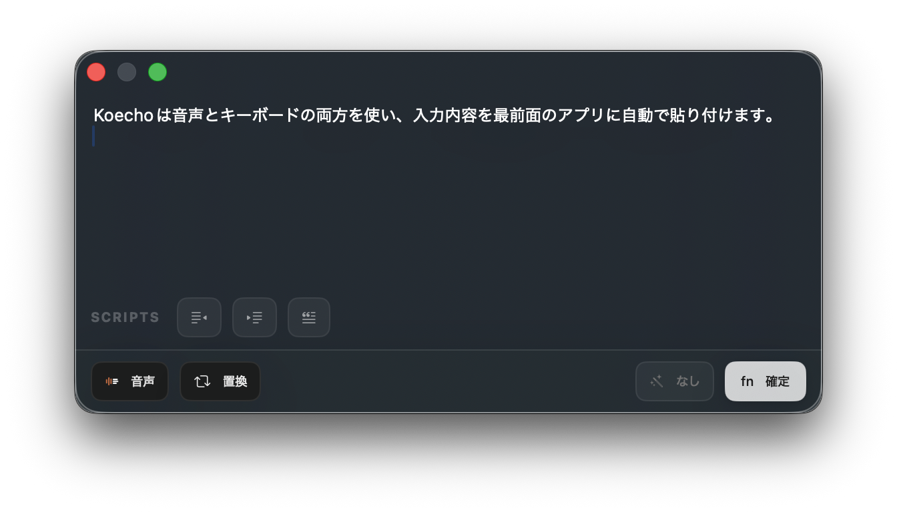

# Koecho（こえこ）

macOS 向けの音声入力+キーボード入力アプリ。
ホットキーで呼び出し、入力したテキストをシェルスクリプトで加工してペーストする。



## 特徴

- 音声入力+キーボード: 音声で入力しながらキーボードで修正できる。認識結果はリアルタイムに反映
- オンデバイス音声認識: 句読点や改行も音声で入力できる
- 内蔵テキスト操作: 外部スクリプトを設定せずに、選択行のインデント増減や引用化ができる
- スクリプト連携: 入力テキストをシェルスクリプトで加工。Apple Foundation Models を使う音声書き起こし整形の例も利用できる

## 動作環境

- macOS 27.0 以上

## インストール

### GitHub Release から

1. [Releases](https://github.com/ryotapoi/Koecho/releases) から最新の zip をダウンロード
2. 解凍して `Koecho.app` を `/Applications` に移動
3. `Koecho.app` を起動。Release 成果物は Apple Developer ID で署名され、Apple の公証を取得済みです。

### ソースからビルド

```bash
git clone https://github.com/ryotapoi/Koecho.git
cd Koecho
open Koecho.xcodeproj
```

Xcode でビルドしてください。

## 必要な権限

初回起動時にシステムから権限の許可を求められます。

- **アクセシビリティ** — テキストのペースト、フォアグラウンドアプリの選択テキスト取得に必要
- **Input Monitoring** — グローバルホットキーの検知に必要
- **マイク** — オンデバイス音声認識に必要

## 使い方

### 基本フロー

1. ホットキー（デフォルト: Fn キー）でフローティングウィンドウを表示
2. 音声またはキーボードでテキストを入力
3. 必要に応じてスクリプトを実行（テキストがその場で置き換わる）
4. ホットキー再押下で確定 → フォアグラウンドアプリにペースト
5. Escape でキャンセル

### スクリプト連携

設定画面でシェルスクリプトを登録できます。スクリプトは `/bin/sh -c` で実行され、stdin にテキスト全文を受け取り、stdout に加工結果を返します。

環境変数でコンテキスト情報も渡されます:

| 環境変数 | 内容 |
|---------|------|
| `KOECHO_SELECTION` | フォアグラウンドアプリの選択テキスト |
| `KOECHO_PROMPT` | スクリプト実行時の追加入力 |
| `KOECHO_SELECTION_START` | 選択範囲の開始位置 |
| `KOECHO_SELECTION_END` | 選択範囲の終了位置 |

動作確認には `examples/echo-env.sh` を使ってください。登録して実行すると、stdin の内容と環境変数の値が表示されます。

### Apple Foundation Models による音声テキスト整形

`examples/fm-textfmt.sh` は、macOS 27 の `/usr/bin/fm` で音声書き起こしを整形するサンプルスクリプトです。stdin からテキストを読み、整形した本文を stdout に返します。

```bash
printf '%s\n' 'えー次の会議は明日ですよろしく' | examples/fm-textfmt.sh
```

整形指示は `examples/fm-textfmt-prompt.md` で編集できます。初回のライセンス手順はスクリプト冒頭のコメントを参照してください。

## ライセンス

[MIT License](LICENSE)
